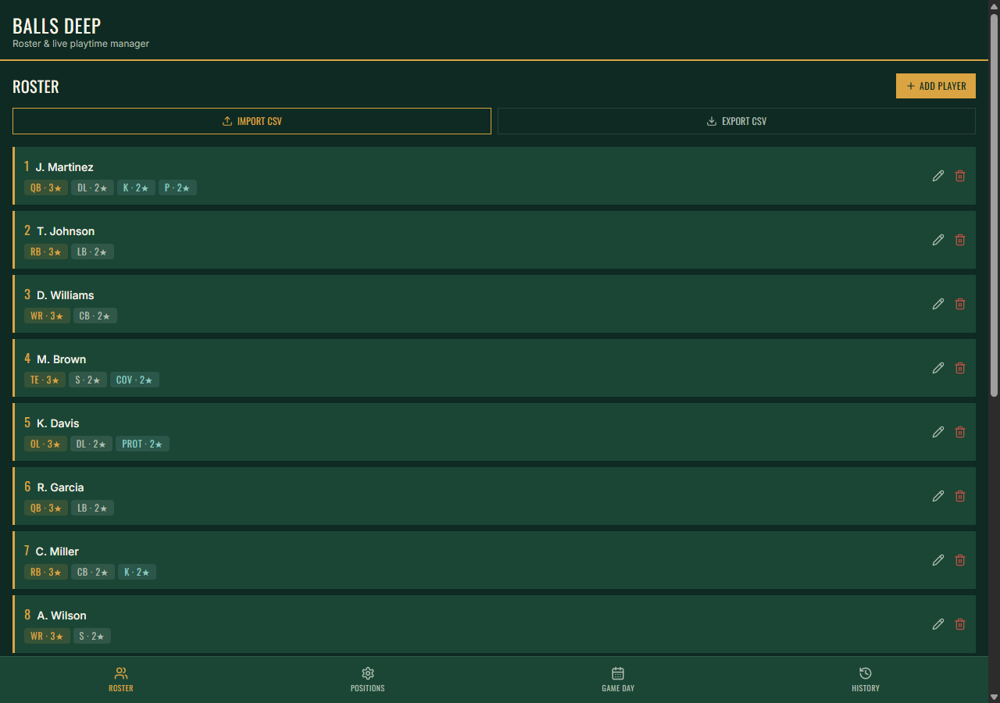
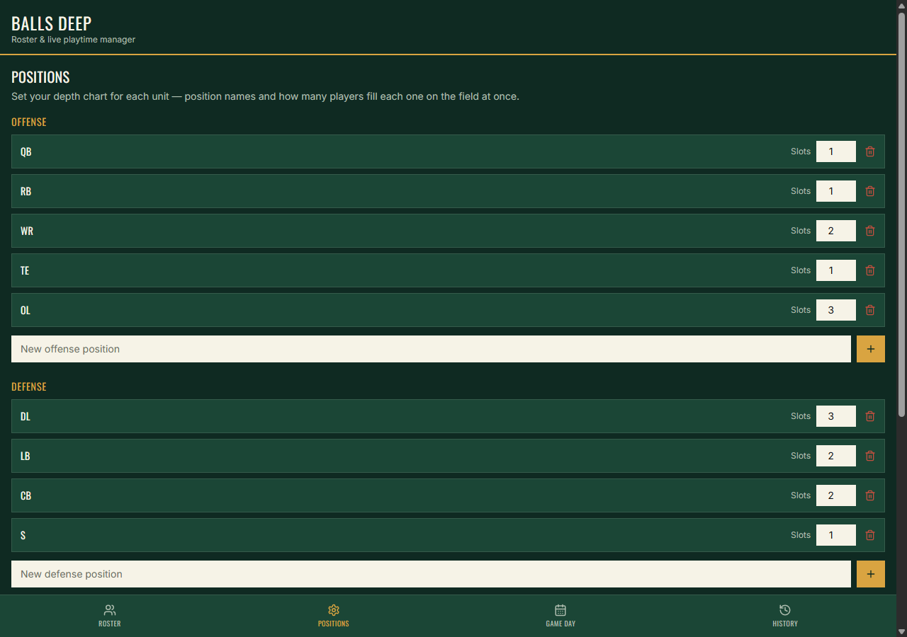
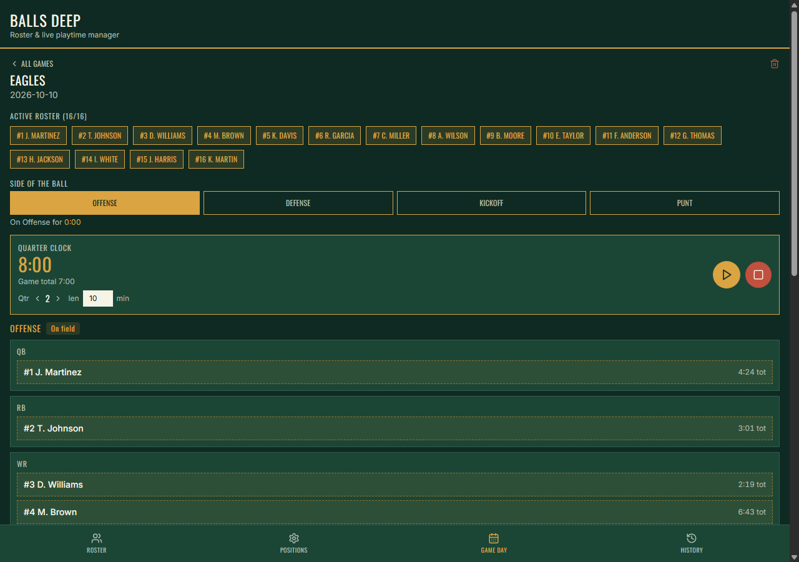
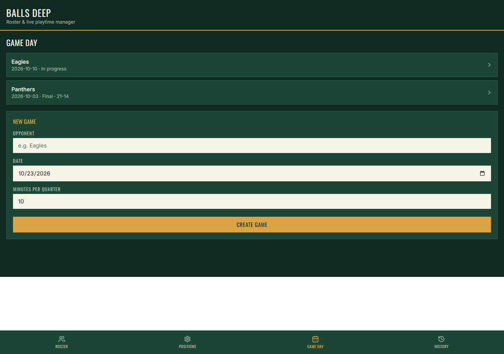
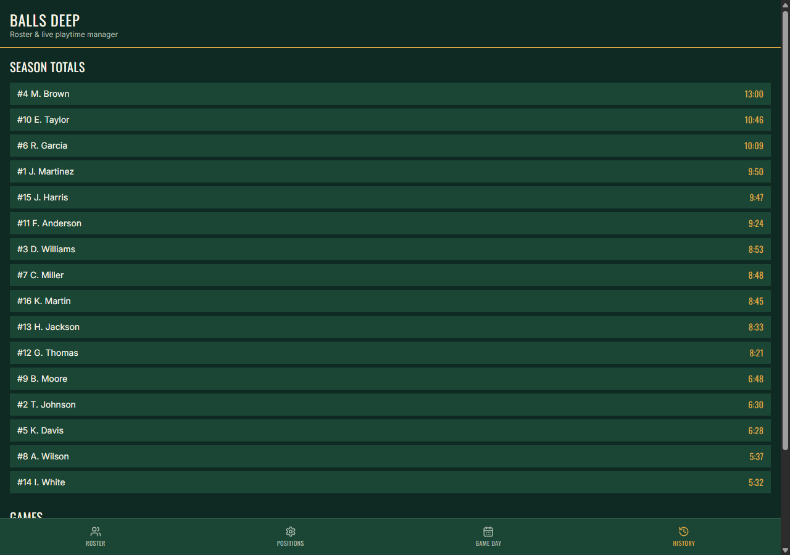

# Balls Deep — Roster & Live Playtime Manager

This is a standalone version of the app you've been using in Claude. It's the
same `App.jsx` code — the only difference is a small storage adapter
(`src/App.jsx`, near the bottom) that uses your browser's `localStorage`
instead of Claude's `window.storage`, since that API only exists inside a
Claude chat. Everything else — roster, positions, live game clock,
substitution suggestions — is identical.

Data is saved locally in whichever browser (or Android WebView) you run it
in. It does **not** sync with the version inside your Claude conversation —
they're separate copies of the app with separate saved data.

## Screenshots

| Roster | Positions |
|--------|-----------|
|  |  |

| Live game | Game list |
|-----------|-----------|
|  |  |

| History |
|---------|
|  |

## Run it locally (Mac/Windows/Linux)

**Prerequisite:** [Node.js](https://nodejs.org) 18 or newer. Check with
`node --version` in a terminal — if that fails, install Node first.

1. Unzip this folder somewhere and open a terminal in it.
2. Install dependencies:
   ```
   npm install
   ```
3. Start the dev server:
   ```
   npm run dev
   ```
4. Open the URL it prints (usually `http://localhost:5173`) in your browser.

That's it — it's a real local web app now. Bookmark it, or leave the
terminal running on the sideline laptop during games. To stop the server,
press `Ctrl+C` in the terminal.

To make a production build (faster, minified) instead of the dev server:
```
npm run build
npm run preview
```

## Turning it into an Android app

The most reliable path is [Capacitor](https://capacitorjs.com), which wraps
your built web app in a real Android project. This part needs a couple of
big installs on your computer (Android Studio) — there's no way around that
for producing an installable Android app, but the steps are straightforward.

### 1. One-time setup

- Install **[Android Studio](https://developer.android.com/studio)**. On
  first launch, let it install the Android SDK (it will prompt you).
- Make sure the project's dependencies are installed if you haven't already:
  ```
  npm install
  ```

### 2. Add the Android project

From this folder:
```
npx cap add android
```
This creates an `android/` folder — a full native Android project that
loads your web app.

### 3. Build the web app and sync it into Android

Every time you change the app and want to see it on Android:
```
npm run build
npx cap sync android
```
(`npm run cap:sync` does both in one step.)

### 4. Open and run in Android Studio

```
npx cap open android
```
This launches Android Studio with the project loaded. From there:
- Plug in an Android phone via USB with **USB debugging** enabled
  (Settings → About phone → tap "Build number" 7 times → Developer options →
  enable USB debugging), or use the built-in emulator.
- Click the green **Run ▶** button in Android Studio. It'll build and
  install the app on your device/emulator.

### 5. Getting a real installable APK (to share without a USB cable)

In Android Studio: **Build → Build App Bundle(s) / APK(s) → Build APK(s)**.
When it finishes, click "locate" in the notification to find the `.apk`
file. You can send that file to any Android phone and install it directly
(the phone will ask you to allow installs from unknown sources the first
time — that's normal for an app that isn't on the Play Store).

### Icon and name

- The app name shown on the phone comes from `capacitor.config.json`
  (`appName`) — already set to "Balls Deep."
- To change the app icon from Android's default, Android Studio has an
  **Image Asset** tool (right-click `android/app/src/main/res` →
  New → Image Asset) that generates all the required icon sizes from one
  image you provide.

### A note on your data

`localStorage` inside an Android WebView is sandboxed per-app, so your
roster and games will stay put across sessions on that phone. It won't
transfer automatically if you reinstall the app or switch phones — for that
you'd want to add a proper export/import (or cloud sync) feature, which is a
reasonable next step once you're using the Android build day to day.
